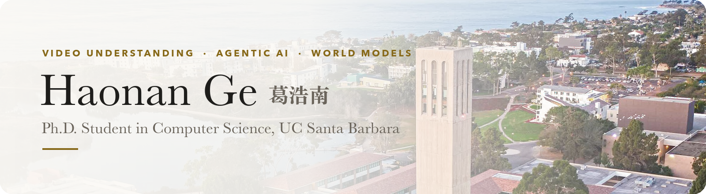

  <a href="https://haonan-ge.github.io">[Homepage]</a> /
  <a href="https://scholar.google.com/citations?user=57W_dVcAAAAJ">[Google Scholar]</a> /
  <a href="https://haonan-ge.github.io/assets/pdf/CV.pdf">[CV]</a>

  
  
  
  
  

🌱 I am a first-year CS Ph.D. student at [UC Santa Barbara](https://www.ucsb.edu/), advised by [Prof. Yao Qin](https://yaoqin1.github.io/). I build multimodal LLMs that perceive, remember, and reason over video, and that act as agents, from streaming video memory to robot-use agents. Before UCSB, I received my bachelor's degree from [Southeast University](https://www.seu.edu.cn/english/).

🔭 I am looking for research internships for **Summer 2027**, and I am always happy to collaborate. Feel free to reach out!

### 📰 News

- **2026.09** · *What Should a Streaming Video Model Remember?* is accepted to **NeurIPS 2026** 🎉
- **2026.09** · Joined UC Santa Barbara as a CS Ph.D. student.
- **2026.01** · *SportR* is accepted to **ICLR 2026**, see you in Rio de Janeiro!

### 📄 Selected Publications

- **What Should a Streaming Video Model Remember?** 
  NeurIPS 2026 · [[Paper]](https://arxiv.org/abs/2606.16353) [[Project]](https://haonan-ge.github.io/selectstream/)
- **FrameMind: Frame-Interleaved Video Reasoning via Reinforcement Learning** 
  Under review · [[Paper]](https://arxiv.org/abs/2509.24008) [[Project]](https://FrameMind.github.io)
- **SportR: A Benchmark for Multimodal Large Language Model Reasoning in Sports** 
  ICLR 2026 · [[Paper]](https://arxiv.org/abs/2511.06499) [[Code]](https://github.com/chili-lab/SportR)
- **MRFD: Multi-Region Fusion Decoding with Self-Consistency for Mitigating Hallucinations in LVLMs** 
  Findings of EMNLP 2025 · [[Paper]](https://aclanthology.org/2025.findings-emnlp.858/) [[Code]](https://github.com/Haonan-Ge/MRFD) [[Project]](https://MRFD1.github.io)

📊 GitHub activity

 

